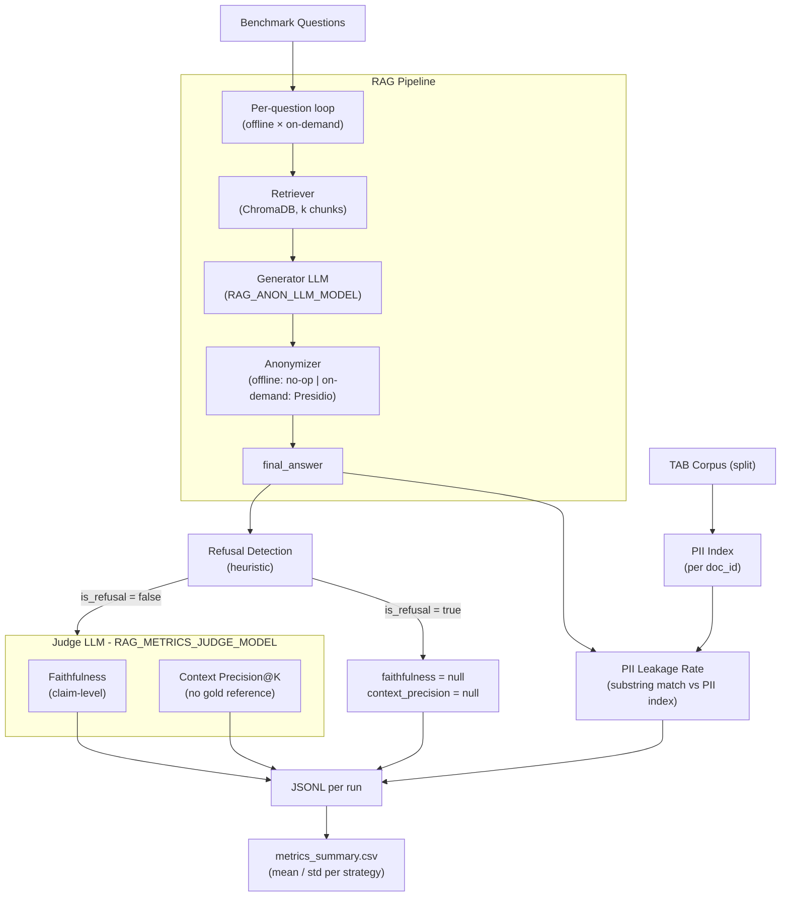

# rag-anonymous-metrics

Computes **Utility** and **Privacy** metrics to quantify the trade-off between information quality and PII protection across Offline/On-Demand anonymization.

## Overview

This package evaluates two anonymization strategies against a benchmark question set drawn from the *[Text Anonymization Benchmark* (TAB) corpus](https://github.com/NorskRegnesentral/text-anonymization-benchmark):

- **Offline:** the corpus is anonymized by Presidio before ingestion; the retriever and generator never see raw PII.
- **On-Demand:** the raw corpus is ingested as-is; Presidio anonymizes only the generated answer at query time.

For each question × strategy the evaluator:

1. Runs the full RAG pipeline (retrieval + generation + optional post-generation anonymization).
2. Computes **privacy metrics** (PII leakage rate, answer refusal) immediately from the final answer.
3. Computes **utility metrics** (faithfulness, context precision) via a separate judge LLM once all answers are collected — refusals are skipped and recorded as `null`.
4. Persists per-query results to JSONL and aggregates to a CSV summary.




## Project structure

```
rag-anonymous-metrics/
├── pyproject.toml          # Package metadata; rag-metrics entry point; depends on rag-anonymous
├── rag_anonymous_metrics/
│   ├── __init__.py
│   ├── config.py           # Load env vars
│   ├── cli.py              # rag-metrics evaluate|export
│   ├── corpus.py           # Load benchmark questions
│   ├── pipeline.py         # Pipeline dataclass: chain + vectordb + anonymizer
│   ├── records.py          # QueryRecord dataclass (JSONL schema)
│   ├── evaluator.py        # Per-question loop, JSONL persistence
│   ├── export.py           # JSONL to metrics via Pandas
│   └── metrics/
│       ├── _judge.py       # Shared judge chain + Yes/No verdict parsing
│       ├── faithfulness.py # Claim-level Ragas faithfulness
│       ├── context_precision.py # Ragas Context Precision@K
│       ├── pii_leakage.py  # Retrieval-conditioned PII leakage rate
│       └── refusal.py      # Heuristic refusal / non-answer detection
├── data/
│   ├── input/
│   │   ├── benchmark_questions_dev.json
│   │   ├── benchmark_questions_train.json
│   │   └── benchmark_questions_test.json
│   └── output/             # JSONL results and metrics
├── Makefile
└── .env.example
```

## Metrics

Utility metrics (faithfulness and context precision) are evaluated by a dedicated **judge LLM** (`RAG_METRICS_JUDGE_MODEL`), which is intentionally different from the generator (`RAG_ANON_LLM_MODEL`) to avoid self-evaluation bias. Privacy metrics (PII leakage rate, answer refusal rate) are computed deterministically and do not involve the judge.

### Faithfulness

The **Faithfulness** metric measures how factually consistent a **response** is with the **retrieved context**. It ranges from **0 to 1**, with higher scores indicating better consistency.

A response is considered **faithful** if all its claims can be supported by the retrieved context.

To calculate this:

1. Identify all the claims in the response.
2. Check each claim to see if it can be inferred from the retrieved context.
3. Compute the faithfulness score using the formula:

$$
\text{Faithfulness} = \frac{\text{Number of claims in the response supported by the retrieved context}}{\text{Total number of claims in the response}}.
$$

**How it’s calculated.** The **response** is `final_answer` (after any strategy-specific anonymisation). **Retrieved context** is the list of chunk texts returned by the retriever. The evaluator performs steps (1)–(2) via prompted decomposition and yes/no verification (`CLAIMS_EXTRACTION_PROMPT`, `CLAIMS_VERIFICATION_PROMPT`). If no claims are extracted or verdicts cannot be parsed, the score is **undefined** and stored as `null`; otherwise the score is in $[0,1]$.

### Context precision

**Context precision** evaluates the retriever’s ability to place **relevant** chunks **higher** than irrelevant ones: it rewards relevant items that appear near the top of the ranked `retrieved_contexts` list.

Ragas defines **Context Precision@K** as:

$$
\text{Context Precision@}K = \frac{\sum_{k=1}^{K} \bigl(\text{Precision@}k \times v_k\bigr)}{\text{Total number of relevant items in the top } K \text{ results}}
$$

$$
\text{Precision@}k = \frac{\text{true positives@}k}{\text{true positives@}k + \text{false positives@}k}
$$

where $K$ is the number of chunks in `retrieved_contexts` and $v_k \in 0,1$ is the relevance indicator at rank $k$. With one binary label per rank, the denominator at cut $k$ is $k$, and $\text{true positives@}k$ is the count of relevant chunks among positions $1..k$, so $\text{Precision@}k$ matches the cumulative precision used here.

**How it’s calculated.** Relevance $v_k$ is judged by the **evaluator LLM** from the **user question** and the **model response** (whether each chunk is useful *for producing that answer*). That matches the Ragas idea of judging chunks against the **generated response** when no gold reference is used—see **Context Utilization** / **LLMContextPrecisionWithoutReference** on the same [Context Precision](https://docs.ragas.io/en/latest/concepts/metrics/available_metrics/context_precision/) page—rather than **Context Precision** with a separate `reference` string. Only the **first 300 characters** of each chunk are shown to the judge. If $\sum_k v_k = 0$, the score is **0**; if no verdicts are parseable, the score is `null`; partial parses are padded with $v_k = 0$ for missing positions.

### Answer refusal rate

Let $R_{\mathrm{ref}} \in 0,1$ be an **abstention indicator** computed by deterministic string heuristics (`rag_anonymous_metrics/metrics/refusal.py`): empty outputs, safety-style refusal phrases, and a small set of short non-answers. This is a **proxy** for model abstention, not a calibrated probability.

Over $N$ benchmark items, the **refusal rate** is

$$  
\rho = \frac{1}{N}\sum_{j=1}^{N} R_{\mathrm{ref}}^{(j)}.  
$$

**Censoring of utility.** When $R_{\mathrm{ref}}=1$, faithfulness and context precision are **omitted** (recorded as `null`) so the judge is not applied to non-answers. Per-run means in `rag_anonymous_metrics/cli.py` average only **defined** judge scores; CSV aggregation reports `mean`, `std`, and **non-null counts** per metric column.

### PII leakage rate

Let $\mathcal{D}_{\mathrm{ret}}$ be the set of **source document IDs** associated with chunks returned for a query. From TAB annotations, define per-document sensitive span sets $\mathcal{P}_d$ as lowercased `span_text` values with `identifier_type` $\in \mathrm{DIRECT},\mathrm{QUASI}$ and length $\geq 2$ after trimming. The **retrieval-conditioned PII inventory** is

$$
\mathcal{P} = \bigcup_{d \in \mathcal{D}_{\mathrm{ret}}} \mathcal{P}_d.
$$

Let $a_{\mathrm{low}} = \mathrm{lower}(a)$ for the final answer $a$. **Leakage** is operationalised as **substring disclosure**:

$$
\mathcal{L} =  p \in \mathcal{P} \mid p \text{ occurs in } a_{\mathrm{low}} .
$$

**Per-query quantities.** `total_pii` $= |\mathcal{P}|$, `leaked_pii` $= |\mathcal{L}|$, and

$$
L = \begin{cases}
|\mathcal{L}|/|\mathcal{P}| & |\mathcal{P}| > 0, 
0 & |\mathcal{P}| = 0.
\end{cases}
$$

Thus $L \in [0,1]$ is **conditional recall of annotated PII** over retrieved documents: it does **not** flag hallucinated identifiers absent from $\mathcal{P}$.

## Prerequisites

1. Ollama running with the required models pulled.
  ```sh
   cd ../rag-anonymous
   make docker-up                  # or run `ollama serve` natively
   make docker-ollama-pull-models  # or `make ollama-pull-models` for the host CLI
  ```
2. Both strategies ingested for the split you will evaluate (`dev`, `train`, or `test`):
  ```sh
   cd ../rag-anonymous
   RAG_ANON_ANONYMIZER_STRATEGY=offline RAG_ANON_CORPUS_SPLIT=dev make ingest
   RAG_ANON_ANONYMIZER_STRATEGY=ondemand RAG_ANON_CORPUS_SPLIT=dev make ingest
  ```

## Setup

```sh
python3.12 -m venv .venv
source .venv/bin/activate

pip install -e ../rag-anonymous
pip install -e ".[dev]"

cp .env.example .env
```

## Usage

### Run full evaluation (both strategies)

```sh
make evaluate
```

### Evaluate a single strategy or corpus split

```sh
RAG_METRICS_EVAL_STRATEGY=offline make evaluate
RAG_METRICS_EVAL_STRATEGY=ondemand make evaluate
RAG_METRICS_CORPUS_SPLIT=train make evaluate
RAG_METRICS_CORPUS_SPLIT=test make evaluate
```

`RAG_METRICS_CORPUS_SPLIT` selects both the TAB JSON used for the PII index and the matching `data/input/benchmark_questions_<split>.json` file.

### Re-export CSV from existing JSONL results

```sh
make export
```

## Output

- **JSONL** (per run): `data/output/results_<model>_<strategy>_<timestamp>.jsonl` — includes `llm_model`, `judge_model`, `answer_is_refusal`, and per-query utility scores.
- **CSV** (aggregated): `data/output/metrics_summary.csv` — means/std per strategy; `answer_is_refusal_mean` is the refusal rate (older JSONL without this field defaults to 0 in export).
- **Archiving experiments:** `make export` loads every `results_*.jsonl` in `data/output/` (not subfolders). Before a new run with different models, move the previous `results_*.jsonl`, `metrics_summary.csv`, and optional `analysis.md` into e.g. `data/output/archive/experiment_<date>_<slug>/` so the next export reflects only the new JSONL files.

## Configuration


| Variable                        | Default                                                    | Description                                                                                                                                                                    |
| ------------------------------- | ---------------------------------------------------------- | ------------------------------------------------------------------------------------------------------------------------------------------------------------------------------ |
| `RAG_ANON_OLLAMA_BASE_URL`      | `http://localhost:11434`                                   | Ollama API endpoint                                                                                                                                                            |
| `RAG_ANON_LLM_MODEL`            | `qwen3:0.6b`                                               | Generator LLM                                                                                                                                                                  |
| `RAG_ANON_LLM_TEMPERATURE`      | `0.0`                                                      | Generation temperature                                                                                                                                                         |
| `RAG_ANON_LLM_REASONING`        | `false`                                                    | Forwards to `ChatOllama(reasoning=...)`; `false` disables thinking for both generator and judge (faster, cleaner Yes/No verdicts). Accepted truthy values: `1`, `true`, `yes`. |
| `RAG_ANON_EMBEDDING_MODEL`      | `nomic-embed-text`                                         | Embeddings model                                                                                                                                                               |
| `RAG_ANON_CHROMADB_PERSIST_DIR` | `../rag-anonymous/chromadb`                                | Shared ChromaDB path                                                                                                                                                           |
| `RAG_ANON_LOG_LEVEL`            | `INFO`                                                     | Application loggers / root level. Accepts `DEBUG`/`INFO`/`WARNING`/`ERROR`/`CRITICAL` or a numeric level. Inherited from the `rag-anonymous` package.                          |
| `RAG_ANON_LOG_LEVEL_HTTP`       | `WARNING`                                                  | Level for HTTP client loggers (`httpx`, `httpcore`, `urllib3`). Default hides per-request lines; raise to `INFO` to inspect every Ollama call.                                 |
| `RAG_ANON_LOG_LEVEL_PRESIDIO`   | `ERROR`                                                    | Level for `presidio-analyzer` / `presidio-anonymizer`. Default suppresses the recognizer startup banner; raise to `INFO` to debug recognizer issues.                           |
| `RAG_METRICS_JUDGE_MODEL`       | `gemma4:e2b` (falls back to `RAG_ANON_LLM_MODEL` if unset) | Judge LLM for faithfulness / context precision only                                                                                                                            |
| `RAG_METRICS_RETRIEVAL_K_DOCS`  | `5`                                                        | Retrieved chunks per query                                                                                                                                                     |
| `RAG_METRICS_EVAL_STRATEGY`     | `all`                                                      | `offline`, `ondemand`, or `all`                                                                                                                                                |
| `RAG_METRICS_CORPUS_SPLIT`      | `dev`                                                      | TAB split (train/dev/test)                                                                                                                                                     |
| `RAG_METRICS_MAX_QUESTIONS`     | *(unset)*                                                  | If set, evaluate only the first N benchmark questions                                                                                                                          |
| `RAG_METRICS_RESULTS_DIR`       | `./data/output`                                            | JSONL + CSV destination                                                                                                                                                        |


