# rag-anonymous-metrics

Computes **Utility** and **Privacy** metrics to quantify the trade-off between information quality and PII protection across Offline/On-Demand anonymization.

## Overview

This package evaluates two anonymization strategies against a benchmark question set drawn from the *[Text Anonymization Benchmark* (TAB) corpus](https://github.com/NorskRegnesentral/text-anonymization-benchmark):

- **Offline:** the corpus is anonymized by Presidio before ingestion; the retriever and generator never see raw PII.
- **On-Demand:** the raw corpus is ingested as-is; Presidio anonymizes only the generated answer at query time.

For each item × strategy the evaluator:

1. Runs the full RAG pipeline (retrieval + generation + optional post-generation anonymization).
2. Computes **privacy metrics** (PII leakage rate, answer refusal) immediately from the final answer.
3. On the **benchmark** suite: computes **utility metrics** (faithfulness, context precision, context recall, factual correctness) via a separate judge LLM — refusals are skipped and recorded as `null`.
4. On the **adversarial** suite: skips Ragas and reports **Attack Success Rate (ASR)** (no judge).
5. Persists per-query results to JSONL.

```mermaid
flowchart TD
    corpus["Corpus (dataset)"] --> pii_index["PII Index\n(per doc_id)"]
    questions["Benchmark Questions"] --> rag

    subgraph rag [RAG Pipeline · per question × strategy]
        retriever["Retriever\n(Elasticsearch, k chunks)"] --> generator["Generator LLM"] --> anon["Anonymizer\n(offline: no-op | on-demand: Presidio)"] --> final_answer["final_answer"]
        generator --> generated_answer["generated_answer"]
    end

    pii_index --> privacy
    final_answer --> privacy["Privacy\n(PII leakage + refusal)"]
    final_answer --> utility["Utility · Judge LLM via Ragas\n(faithfulness, context precision/recall,\nfactual correctness — null if refusal)"]
    ground_truth["ground_truth"] --> utility

    privacy --> jsonl["JSONL per run"]
    utility --> jsonl
```




## Project structure

```
rag-anonymous-metrics/
├── pyproject.toml          # Package metadata; rag-metrics entry point; depends on rag-anonymous
├── rag_anonymous_metrics/
│   ├── __init__.py
│   ├── config.py           # Load env vars
│   ├── cli.py              # rag-metrics run
│   ├── corpus.py           # Load benchmark questions + adversarial attacks
│   ├── records.py          # QueryRecord dataclass (JSONL schema)
│   ├── run.py              # Pipeline per-question loop
│   └── metrics/
│       ├── adversarial.py  # ASR summary helpers
│       ├── privacy.py      # PII leakage index/rate + refusal heuristics
│       └── utility.py      # Ragas faithfulness + context precision (judge LLM)
├── data/
│   ├── input/
│   │   ├── adversarial_attacks_{dev,train,test}.json
│   │   ├── benchmark_questions_{dev,train,test}.json
│   │   └── …
│   └── output/             # Results and metrics
├── notebooks/              # Jupyter Notebooks for analysis
├── Makefile
└── .env.example
```


## Metrics

Utility metrics (faithfulness, context precision, context recall, factual correctness) are computed by the [Ragas](https://docs.ragas.io) framework, driven by a dedicated **judge LLM** (`RAG_METRICS_JUDGE_MODEL`) that is intentionally different from the generator (`RAG_ANON_LLM_MODEL`) to avoid self-evaluation bias. Context recall and factual correctness compare against the benchmark `ground_truth`; faithfulness and context precision do not use a reference. Privacy metrics (PII leakage rate, answer refusal rate) are computed deterministically and do not involve Ragas or the judge.

### Faithfulness

The **Faithfulness** metric measures how factually consistent a **response** is with the **retrieved context**. It ranges from **0 to 1**, with higher scores indicating better consistency.

A response is considered **faithful** if all its claims can be supported by the retrieved context.

To calculate this:

1. Identify all the claims in the response.
2. Check each claim to see if it can be inferred from the retrieved context.
3. Compute the faithfulness score using the formula:

$$
\text{Faithfulness} = \frac{\text{Number of claims in the response supported by the retrieved context}}{\text{Total number of claims in the response}}.
$$

**How it’s calculated:** Computed by Ragas' `[Faithfulness](https://docs.ragas.io/en/latest/concepts/metrics/available_metrics/faithfulness/)` metric. The **response** is `final_answer` (after any strategy-specific anonymisation) and the **retrieved context** is the list of chunk texts returned by the retriever, passed as a `SingleTurnSample`. Ragas performs steps (1)–(2) — claim decomposition and per-claim verification — internally via the judge LLM. If no claims are extracted the score is **undefined** (Ragas returns `NaN`) and stored as `null`; otherwise the score is in $[0,1]$.

### Context precision

**Context precision** evaluates the retriever’s ability to place **relevant** chunks **higher** than irrelevant ones: it rewards relevant items that appear near the top of the ranked `retrieved_contexts` list.

Ragas defines **Context Precision@K** as:

$$
\text{Context Precision@}K = \frac{\sum_{k=1}^{K} \bigl(\text{Precision@}k \times v_k\bigr)}{\text{Total number of relevant items in the top } K \text{ results}}
$$

$$
\text{Precision@}k = \frac{\text{true positives@}k}{\text{true positives@}k + \text{false positives@}k}
$$

where $K$ is the number of chunks in `retrieved_contexts` and $v_k \in 0,1$ is the relevance indicator at rank $k$. With one binary label per rank, the denominator at cut $k$ is $k$, and $\text{true positives@}k$ is the count of relevant chunks among positions $1..k$, so $\text{Precision@}k$ matches the cumulative precision used here.

**How it’s calculated:** Computed by Ragas' `[LLMContextPrecisionWithoutReference](https://docs.ragas.io/en/latest/concepts/metrics/available_metrics/context_precision/)` metric. Relevance $v_k$ is judged by the **judge LLM** from the **user question** and the **model response** (whether each chunk is useful *for producing that answer*) — the without-reference variant, since we have no gold `reference` string. Ragas computes the weighted Precision@$k$ formula above internally over the full `retrieved_contexts` list. If $\sum_k v_k = 0$ the score is **0**; if the metric cannot be computed it returns `NaN` and is stored as `null`.

### Context recall

**Context recall** measures whether the **retrieved context** contains the information needed to produce the **reference answer** (`ground_truth`). It is the retrieval complement of context precision: precision penalises irrelevant chunks, recall penalises *missing* relevant chunks. It ranges from **0 to 1**, with higher scores indicating that more of the reference answer is supported by the retrieved context.

$$
\text{Context Recall} = \frac{\text{Number of reference claims attributable to the retrieved context}}{\text{Total number of reference claims}}.
$$

**How it’s calculated:** Computed by Ragas' `[LLMContextRecall](https://docs.ragas.io/en/latest/concepts/metrics/available_metrics/context_recall/)` metric. Ragas decomposes the `ground_truth` into claims and, via the **judge LLM**, checks each claim against the `retrieved_contexts`. This is the signal most sensitive to the **offline** strategy, where anonymising the corpus *before* indexing can remove the anchors a query relies on. If the metric cannot be computed it returns `NaN` and is stored as `null`.

### Factual correctness

**Factual correctness** measures how well the **model response** agrees with the **reference answer** (`ground_truth`), independent of the retrieved context. Whereas faithfulness asks whether the answer is grounded in *what was retrieved*, factual correctness asks whether it matches *the truth*. It ranges from **0 to 1**.

**How it’s calculated:** Computed by Ragas' `[FactualCorrectness](https://docs.ragas.io/en/latest/concepts/metrics/available_metrics/factual_correctness/)` metric. Ragas decomposes both the **response** and the `ground_truth` into claims and uses the **judge LLM** to verify them against each other (natural-language inference), reporting an F1-style score over supported claims. This is the cleanest **utility** signal for the privacy/utility trade-off: it quantifies how much anonymisation degrades the correctness of answers relative to the gold reference. If the metric cannot be computed it returns `NaN` and is stored as `null`.

Unlike the other utility metrics, factual correctness is **not censored on refusal**: a refusal delivers zero correct facts, so it is scored **0** rather than `null`. This makes factual correctness an **end-to-end utility** measure — averaged over *all* benchmark questions, including refusals — so it stays comparable across strategies regardless of how often each one abstains. The other three metrics remain *conditional on answering* (refusals → `null`), so always read them alongside the refusal rate.

### Answer refusal rate

Let $R_{\mathrm{ref}} \in 0,1$ be an **abstention indicator** computed by deterministic string heuristics.

Over $N$ benchmark items, the **refusal rate** is

$$  
\rho = \frac{1}{N}\sum_{j=1}^{N} R_{\mathrm{ref}}^{(j)}.  
$$

**Censoring of utility:** When $R_{\mathrm{ref}}=1$, faithfulness, context precision and context recall are **omitted** (recorded as `null`) so the judge is not applied to non-answers — these stay *conditional on answering*. **Factual correctness is the exception**: a refusal is scored **0**, making it an end-to-end utility measure over all questions (see [Factual correctness](#factual-correctness)).

### PII leakage rate

**Naming.** Pipeline stages are `generated` (LLM output, `generated_answer`) and `final` (system output, `final_answer`). Privacy metrics use domain prefix `pii_` and stage suffix `_generated` or `_final` — e.g. `pii_leakage_rate_final`, `pii_total_generated`.

Let $\mathcal{D}_{\mathrm{ret}}$ be the set of **source document IDs** associated with chunks returned for a query. From TAB annotations, define per-document sensitive span sets $\mathcal{P}_d$ as lowercased `span_text` values with `identifier_type` $\in \mathrm{DIRECT},\mathrm{QUASI}$ and length $\geq 2$ after trimming. The **retrieval-conditioned PII inventory** is

$$
\mathcal{P} = \bigcup_{d \in \mathcal{D}_{\mathrm{ret}}} \mathcal{P}_d.
$$

Let $a_{\mathrm{low}} = \mathrm{lower}(a)$ for the final answer $a$. **Leakage** is operationalised as **substring disclosure**:

$$
\mathcal{L} =  p \in \mathcal{P} \mid p \text{ occurs in } a_{\mathrm{low}} .
$$

**Per-query quantities:** `pii_total_final` $= |\mathcal{P}|$, `pii_leaked_final` $= |\mathcal{L}|$, and

$$
L = \begin{cases}
|\mathcal{L}|/|\mathcal{P}| & |\mathcal{P}| > 0, 
0 & |\mathcal{P}| = 0.
\end{cases}
$$

Thus $L \in [0,1]$ is **conditional recall of annotated PII** over retrieved documents: it does **not** flag hallucinated identifiers absent from $\mathcal{P}$.

A parallel **PERSON/DIRECT** inventory (`pii_person_*`) uses only TAB spans with `entity_type = PERSON` and `identifier_type = DIRECT`, aligned with the Presidio policy and nominal extraction attacks.

**Per-strategy aggregates.** Over the set of queries $Q$ for a strategy, the summary reports two averages of leakage. The **macro-average** (`leak_macro`) weights each query equally:

$$
L_{\mathrm{macro}} = \frac{1}{|Q|} \sum_{q \in Q} L_q.
$$

The **micro-average** (`leak_micro`) weights each PII span equally by pooling counts before dividing:

$$
L_{\mathrm{micro}} = \frac{\sum_{q \in Q} |\mathcal{L}*q|}{\sum*{q \in Q} |\mathcal{P}_q|} \quad (0 \text{ if the denominator is } 0).
$$

Macro answers *"what is the typical per-query leakage?"*; micro answers *"what share of all retrieved PII leaked?"*. Queries with $|\mathcal{P}_q| = 0$ contribute $L_q = 0$ to the macro mean but add nothing to either micro sum.

## Setup


### 1. Ollama

The pipeline talks to Ollama over its HTTP API at `RAG_ANON_OLLAMA_BASE_URL` (default `http://localhost:11434`). Two equivalent ways to bring it up — pick one:

**Option A — Native CLI / desktop app** (install from [https://ollama.com](https://ollama.com)):

```sh
ollama serve                      # or just launch the Ollama desktop app
cd ../rag-anonymous && make ollama-pull-models
cd ../rag-anonymous && make docker-up   # Elasticsearch only
```

Both paths expose the same API on port `11434`, so the rest of the pipeline doesn't need to know which one is running. **Don't run both at once** — they'll race for the port and the second one will fail to bind.

**Option B — Docker** (from `rag-anonymous/`, `ollama` compose profile):

```sh
cd ../rag-anonymous
make docker-up-ollama             # Ollama + Elasticsearch
make docker-ollama-pull-models    # pull models inside the container
```

Docker Compose targets (run from `rag-anonymous/`):

```sh
make docker-up                    # Elasticsearch only
make docker-up-ollama             # + Ollama
make docker-up-kibana             # + Kibana (http://localhost:5601)
make docker-up-all                # Elasticsearch + Ollama + Kibana

make docker-ollama-down           # stop Ollama only
make docker-kibana-down           # stop Kibana only
make docker-down                  # stop and remove all running compose services
```


### 2. Python package

```sh
python3.12 -m venv .venv
source .venv/bin/activate

pip install -e ../rag-anonymous
pip install -e .

cp .env.example .env
```


## Usage


### Prerequisites

1. Offline and On-Demand strategies ingested for the dataset you will evaluate (`dev`, `train`, or `test`):
  ```sh
   cd ../rag-anonymous
   RAG_ANON_ANONYMIZER_STRATEGY=offline RAG_ANON_CORPUS_DATASET=dev make ingest
   RAG_ANON_ANONYMIZER_STRATEGY=ondemand RAG_ANON_CORPUS_DATASET=dev make ingest
  ```
2. Sanity-check the judge

Verifies the judge LLM before trusting its scores: feeds each question's own ground truth as the answer (`factual_correctness` should be ~1.0) and another question's ground truth as a control (should be ~0.0). Exits non-zero if the judge is unreliable.

```sh
make check-judge
RAG_METRICS_JUDGE_MODEL=gemma4:12b RAG_METRICS_QUESTIONS_CATEGORY=all RAG_METRICS_QUESTIONS_RANGE=1-5 make check-judge
```

It uses `RAG_METRICS_JUDGE_MODEL`, `RAG_METRICS_CORPUS_DATASET`, `RAG_METRICS_QUESTIONS_CATEGORY`, and `RAG_METRICS_QUESTIONS_RANGE`.

### Run full evaluation (Offline and On-Demand strategies)

```sh
make run
```

With `RAG_METRICS_QUESTIONS_CATEGORY=all`, the run evaluates the benchmark (utility + privacy) and then the adversarial suite (ASR only, no Ragas).

### Run a single strategy, dataset, category, or id range

```sh
RAG_METRICS_STRATEGY=offline make run
RAG_METRICS_STRATEGY=ondemand make run
RAG_METRICS_CORPUS_DATASET=train make run
RAG_METRICS_CORPUS_DATASET=test make run
RAG_METRICS_QUESTIONS_CATEGORY=identity RAG_METRICS_QUESTIONS_RANGE=all make run
RAG_METRICS_QUESTIONS_CATEGORY=all RAG_METRICS_QUESTIONS_RANGE=1-60 make run
RAG_METRICS_QUESTIONS_CATEGORY=adversarial RAG_METRICS_QUESTIONS_RANGE=1-15 make run
```

`RAG_METRICS_CORPUS_DATASET` selects both the TAB JSON used for the PII index and the matching input files (`benchmark_questions_<dataset>.json`, `adversarial_attacks_<dataset>.json`).

`RAG_METRICS_QUESTIONS_CATEGORY` selects the evaluation suite:

- `all` — benchmark + adversarial (range applies only to the benchmark)
- `factual` / `identity` — benchmark filtered by `category`
- `adversarial` — adversarial attacks only

`RAG_METRICS_QUESTIONS_RANGE` recuts by numeric `id` (`all` or `START-END`).


## Output

- **Per experiment:** outputs go under `data/output/<YYYYMMDD_HHMMSS>/` (timestamp when the run starts). Each folder contains:
  - `results_offline.jsonl` and/or `results_ondemand.jsonl` (benchmark; depends on `RAG_METRICS_STRATEGY`) — includes `llm_model`, `judge_model`, `answer_is_refusal`, and per-query utility scores.
  - `results_offline_adversarial.jsonl` and/or `results_ondemand_adversarial.jsonl` when the adversarial suite runs — privacy fields (`pii_*`, `pii_person_*`) + `ASR_tab` / `ASR_person` summary in the logs (no Ragas scores).


## Configuration


| Variable                         | Default                                                    | Description                                                                                                                                                                       |
| -------------------------------- | ---------------------------------------------------------- | --------------------------------------------------------------------------------------------------------------------------------------------------------------------------------- |
| `RAG_ANON_CORPUS`                | TAB ECHR URL template                                      | Corpus source (URL or local path) with optional `{dataset}`, used by `rag_anonymous.load_corpus` to build the PII index. `{dataset}` is filled from `RAG_METRICS_CORPUS_DATASET`. |
| `RAG_ANON_EMBEDDING_MODEL`       | `nomic-embed-text`                                         | Embeddings model                                                                                                                                                                  |
| `RAG_ANON_ES_URL`                | `http://localhost:9200`                                    | Elasticsearch base URL (shared with `rag-anonymous`)                                                                                                                              |
| `RAG_ANON_LLM_MODEL`             | `qwen3:8b`                                                 | Generator LLM                                                                                                                                                                     |
| `RAG_ANON_LLM_REASONING`         | `false`                                                    | Forwards to `ChatOllama(reasoning=...)`; `false` disables thinking for both generator and judge (faster, cleaner Yes/No verdicts). Accepted truthy values: `1`, `true`, `yes`.    |
| `RAG_ANON_LLM_TEMPERATURE`       | `0.0`                                                      | Generation temperature                                                                                                                                                            |
| `RAG_ANON_LOG_LEVEL`             | `INFO`                                                     | Application loggers / root level. Accepts `DEBUG`/`INFO`/`WARNING`/`ERROR`/`CRITICAL` or a numeric level. Inherited from the `rag-anonymous` package.                             |
| `RAG_ANON_LOG_LEVEL_HTTP`        | `WARNING`                                                  | Level for HTTP client loggers (`httpx`, `httpcore`, `urllib3`). Default hides per-request lines; raise to `INFO` to inspect every Ollama call.                                    |
| `RAG_ANON_LOG_LEVEL_PRESIDIO`    | `ERROR`                                                    | Level for `presidio-analyzer` / `presidio-anonymizer`. Default suppresses the recognizer startup banner; raise to `INFO` to debug recognizer issues.                              |
| `RAG_ANON_OLLAMA_BASE_URL`       | `http://localhost:11434`                                   | Ollama API endpoint                                                                                                                                                               |
| `RAG_METRICS_CORPUS_DATASET`     | `dev`                                                      | TAB dataset (`train` / `dev` / `test`); required                                                                                                                                  |
| `RAG_METRICS_JUDGE_MODEL`        | `gemma4:12b` (falls back to `RAG_ANON_LLM_MODEL` if unset) | Judge LLM for Ragas utility metrics                                                                                                                                               |
| `RAG_METRICS_QUESTIONS_CATEGORY` | — (required)                                               | `all`, `factual`, `identity`, or `adversarial`                                                                                                                                    |
| `RAG_METRICS_QUESTIONS_RANGE`    | — (required)                                               | `all` or `START-END` by numeric `id` (e.g. `1-60`)                                                                                                                                |
| `RAG_METRICS_RESULTS_DIR`        | `./data/output`                                            | Base directory; each run creates a timestamped subfolder with JSONL outputs                                                                                                       |
| `RAG_METRICS_RETRIEVAL_K_DOCS`   | `3`                                                        | Retrieved chunks per query                                                                                                                                                        |
| `RAG_METRICS_STRATEGY`    | — (required)                                               | `offline`, `ondemand`, or `all`                                                                                                                                                   |


